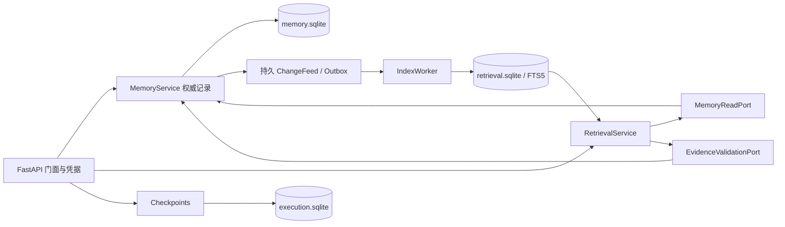

# 基础切片的模块契约

来源：父目录 `融合召回方案/Agent记忆中间件完整技术方案.md` v1.3。实施日期 2026-10-28；当前实现版本 0.1.0。完整需求保留，以下只描述实际已实现边界。

## 所有权与交接

| 节点 | 输入与前置条件 | 输出及完成条件 | 失败与恢复 | 责任方 |
| --- | --- | --- | --- | --- |
| 身份与事件校验 | Bearer 对应固定 tenant/project/connector/origin/actor 映射；事件 1.1 | Scope 和通过校验的事件；客户端无权填写权威字段 | 401/403/422；不写入 | 门面/控制面 |
| 权威提交 | 幂等键、规范正文摘要、源版本顺序 | 原始版本、当前 head、删除状态、日志序号和 ChangeFeed 同事务；回执 1.2 | 同键异内容、delivery 冲突、旧版本返回 409；事务失败不确认 | 记忆管理 |
| 索引交接 | 同日志连续变更；指定版本经 MemoryReadPort 读取 | FTS 投影和覆盖水位在索引库同事务持久化 | 崩溃按旧水位重放；不跨过失败位置；单进程资源锁限制 writer | 召回 indexing |
| 查询与补查 | 固定 Scope、日志位置、generation 与预算 | FTS 候选、受限近期原文，缺失区间显式返回 | 必需能力未就绪为 202；best_effort 标 partial；查询不写事实或索引 | 召回 search |
| 证据放行 | 候选 source ID/revision | 首次与最终权威快照验证；仅活跃、未删除且同范围证据可输出 | 核验不可用为 503；并发删除后剔除，最终点之后的删除无法撤回已发送字节 | 记忆核验 / 召回装配 |
| checkpoint | 单独权限、工作流版本、CAS、幂等键 | 独立状态库保存与回读 | 409 冲突；重启恢复；不修改长期事实 | 执行状态 |

`contracts.py` 只包含 DTO、Protocol 与错误，不导入数据库。记忆管理不导入召回；召回只引用公开内存端口，不引用记忆内部仓储。在线查询仅接收 reader；writer 只注入 worker。架构测试扫描实际依赖，行为测试检查纯查询不改权威日志。

## 实施选择与差异

- 方案的模块化单服务已经建立；三个 SQLite 文件分别隔离权威、检索和执行状态。目录不是三个独立服务，共享同一进程故障域。标准库 sqlite3 采用参数化 SQL 和单版本迁移，尚未接入方案建议的 SQLAlchemy/Alembic；云 provider 引入前必须实现迁移演进，不直接扩展散落 SQL。
- changes 同时承担持久 Outbox 与可重放 ChangeFeed，不在消费后删除；投影的消费位点等于同事务落盘的连续覆盖。当前一个 worker 顺序执行，故不伪造多进程 lease/fence；独立 worker 部署尚不支持。
- 索引清单绑定 tokenizer、正文、切块、过滤版本；每项目水位绑定 log_id。换版本拒绝复用旧清单，需要后续 generation 重建/切换控制面。本版测试了另库从完整保留日志重建，尚无游标过期/影子切换协议。
- CJK unigram/bigram 与 ASCII 型号分词是明确版本化的起点；FTS5 使用 BM25。它不是语义 embedding，也没有中文质量评测结论。融合使用 RRF 合并 lexical/recent_raw 路线，不将 BM25 原始分数直接相加。
- 预算以 UTF-8 字节作为常见 byte/subword tokenizer 的保守估计；结果同时暴露估算器和截断标记。尚无模型特定 tokenizer、图片 token 预算或摘要压缩。
- 本版只接受 text/tool_result 内容。未配置/未实现模型能力为 unavailable；不返回假向量、空的已确认事实或声称 OCR 已完成。
- 认证范围在启动时固定。租户/项目隔离经过测试，动态 ACL、共享空间、目的交集、连接器 generation/lease 和路由切换尚未实现。根目录使用本机用户权限继承，不宣称加密或已完成完整目录安全预检。
- 删除为逻辑 tombstone，保留权威历史用于审计，立即阻止公开读取；索引异步清理。物理清理、媒体引用计数、派生 lineage 和训练删除传播在后续阶段实现。

## 错误与可恢复性

核心错误包含 code/message/retryable/request_id/details。未认证 401，范围/主体越权 403，未知或失效来源 404，冲突 409，已删源未经恢复写入 410，不合法契约 422，正文超限 413，存储/核验不可用 503。所有成功回执对应已提交事务；网络结果未知时用相同幂等事件重试。

索引失败按 1/2/4/8 秒退避重试，单项目最多五次后停止，进度显示 failed；修复后重启可从持久水位续建。attempt 计数本版只在进程内，完整 jobs/lease/dead-letter 和人工重放接口尚未实现。索引缺失、损坏或清单不兼容时保留权威提交能力。

健康接口的 ready 指基础服务可运行，具体功能是否就绪必须看 `/v1/capabilities`。默认仅监听 loopback，访问日志关闭，异常响应不回显正文/凭据。尚未提供网络部署所需 TLS、动态权限控制与容量背压。
